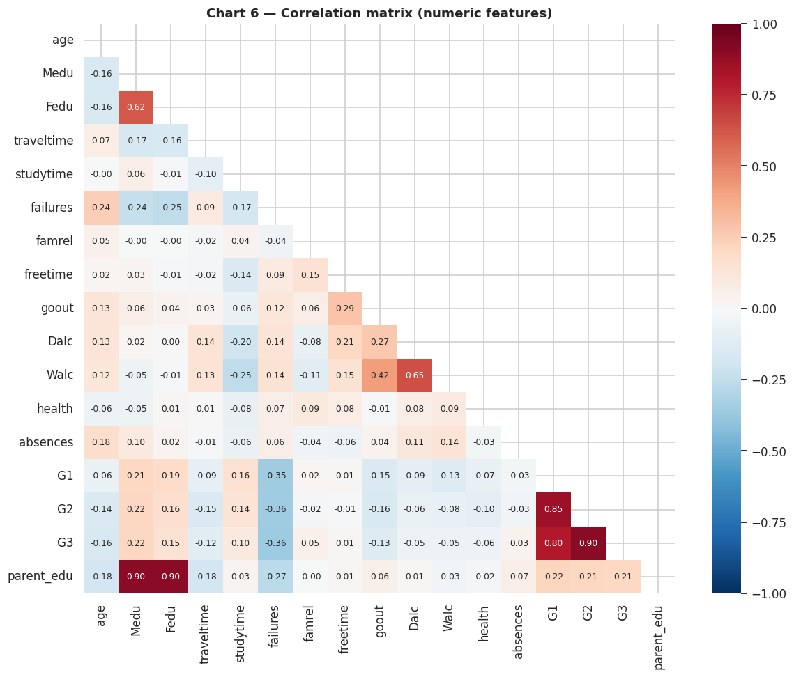
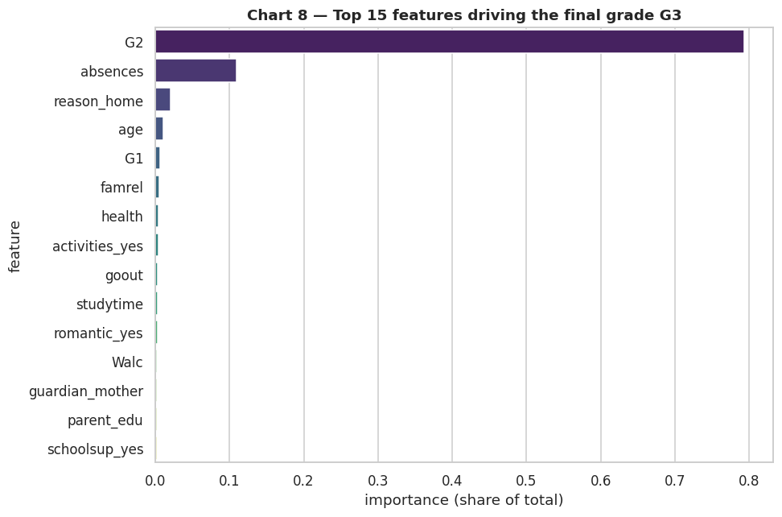
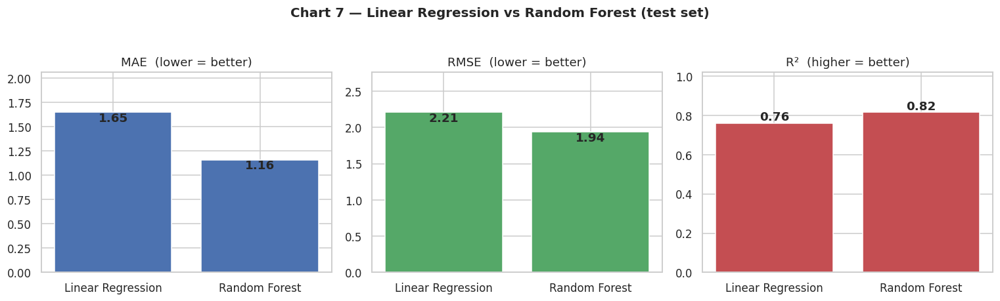

# 🎓 Student Performance Predictor

**Predicting student final grades with Python and scikit-learn** — a full data-science project: exploratory analysis of what drives exam performance, plus two regression models (Linear Regression vs Random Forest) that predict the final grade.

👤 **Author:** Ahmed Abrar Tahseen · 📅 November 2026 · 🏷️ Project 1 of the GitHub Portfolio Project Pack (Data Science)

---

## 📌 The problem

Schools collect a lot about their students — study time, absences, family background, social life, and earlier grades (G1, G2). **Which of these actually moves the final grade (G3)?** And can a machine-learning model predict G3 for a student it has never seen?

## 📊 Dataset

[UCI Machine Learning Repository — Student Performance Data Set](https://archive.ics.uci.edu/dataset/320/student+performance) (also mirrored on [Kaggle](https://www.kaggle.com/datasets/uciml/student-performance) — search *"UCI student performance"*).

| File | Subject | Records | Attributes |
|---|---|---|---|
| `data/student-mat.csv` | Mathematics | 395 | 33 |
| `data/student-por.csv` | Portuguese | 649 | 33 |

Grades: **G1** = first period, **G2** = second period, **G3** = final grade (0–20). ⚠️ The CSVs use `;` as separator. Attribute descriptions: `data/student.txt`.

## 🛠️ Tools

Python · pandas · numpy · matplotlib · seaborn · scikit-learn · Jupyter Notebook

## 🔑 Key findings

1. **Earlier grades are the strongest signal** — G2 correlates with G3 at r = 0.90 and G1 at r = 0.80, far more than any habit.
2. **Study time helps; past failures hurt** — median G3 rises from 10 (under 2 h study/week) to 12 (over 10 h/week); `failures` is the strongest habit signal (r = −0.36).
3. **Going out shows a mild trade-off** (median G3 11 → 10 as `goout` rises), while **absences show almost no *linear* link** (r ≈ +0.03) — yet the Random Forest still ranks absences a top feature, i.e. a **non-linear effect**.
4. **A Random Forest predicts G3 with R² = 0.82 / MAE = 1.16 points** on held-out students — clearly better than Linear Regression (R² = 0.76); 5-fold cross-validation agrees (0.90 ± 0.03 vs 0.84 ± 0.03).
5. **Without G1/G2 the honest "early-warning" model drops to R² ≈ 0.25** — modest, but enough to flag at-risk students at the start of the year. The same pipeline on the Portuguese subject gives RF R² = 0.84, so the story generalises.

## 📈 Results (Math, held-out 20% test set)

| Model | MAE ↓ | RMSE ↓ | R² ↑ | 5-fold CV R² (train) |
|---|---|---|---|---|
| Linear Regression (baseline) | 1.653 | 2.212 | 0.761 | 0.844 ± 0.029 |
| **Random Forest** (best: `n_estimators=100`) | **1.161** | **1.938** | **0.817** | **0.905 ± 0.025** |
| Random Forest *without G1/G2* (stretch) | 3.154 | 3.916 | 0.252 | — |

| Subject | Linear Regression R² | Random Forest R² |
|---|---|---|
| Math (395 students) | 0.761 | **0.817** |
| Portuguese (649 students) | 0.849 | **0.841** |

**Top 5 drivers of G3 (Random Forest feature importance):** `G2` (0.79), `absences` (0.11), `reason_home` (0.02), `age` (0.01), `G1` (0.01).

## 🖼️ Charts

**Correlation heatmap** — earlier grades dominate:



**Feature importance** — what the model actually uses:



**Model comparison** — Random Forest beats the linear baseline:



All 11 charts are in [`figures/`](figures/) (`01`–`11`), regenerated automatically when the notebook runs.

## ▶️ How to run

```bash
git clone <this-repo-url>
cd student-performance-predictor
pip install -r requirements.txt
jupyter notebook student_performance_predictor.ipynb   # Kernel → Restart & Run All
```

The notebook reads `data/student-mat.csv` / `data/student-por.csv` and saves every chart into `figures/`.

## 🗂️ Project structure

```
student-performance-predictor/
├── student_performance_predictor.ipynb   # the full, executed analysis (10 steps + stretch goals)
├── figures/                              # 11 charts (PNG)
├── data/
│   ├── student-mat.csv                   # UCI dataset — Math (395 rows)
│   ├── student-por.csv                   # UCI dataset — Portuguese (649 rows)
│   └── student.txt                       # attribute descriptions
├── requirements.txt
└── README.md
```

## 📝 What the notebook covers

1. Load both CSVs (`;` separator) — shape, head, info
2. Data quality: missing values, duplicates, dtypes
3. EDA — 6 charts: grade distributions, study time, absences, parental education, going out, correlation heatmap
4. Preprocessing — one-hot vs label encoding, X/y, 80/20 train/test split (and *why* a test set)
5. Linear Regression baseline — MAE / RMSE / R² explained
6. Random Forest + GridSearchCV + 5-fold cross-validation, results table
7. Feature importance — top 5 drivers vs the EDA
8. Actual vs predicted plot
9. Stretch: predicting G3 **without** G1/G2 (the honest early-warning problem)
10. Stretch: the same pipeline on the Portuguese subject
11. Five-bullet summary for non-technical readers

## 💼 CV bullet (once pushed)

> Built a machine-learning model in Python (scikit-learn) predicting student exam scores from study behaviour, with full EDA and model evaluation.

## 📄 License

Dataset © UCI Machine Learning Repository ([CC BY 4.0](https://creativecommons.org/licenses/by/4.0/)). Code and analysis: MIT License.
